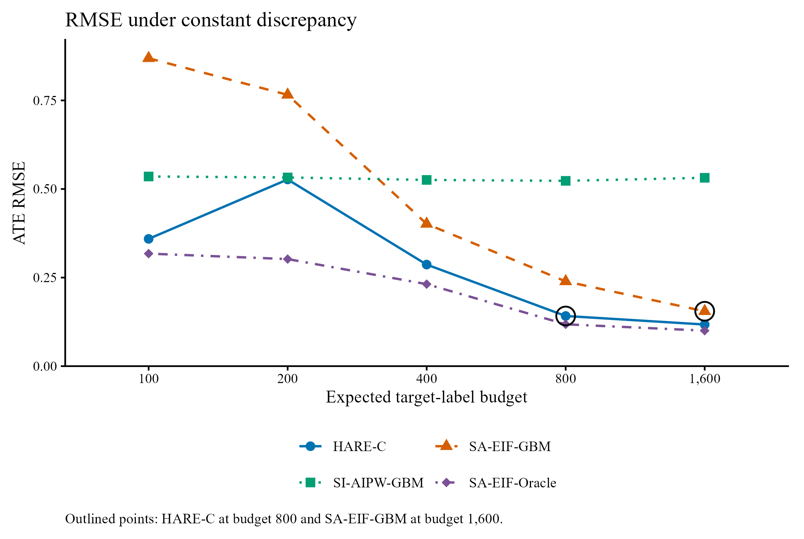

# HARE: History-Assisted Residual Estimation

Simulation code accompanying Siyu Chen's writing sample, **HARE: History-Assisted Residual Estimation of Long-Term Treatment Effects with Limited Target Outcomes**.

HARE combines an outcome predictor learned from historical data with treatment-specific corrections learned from a small labeled target sample. This repository studies HARE-C, which uses a constant residual correction in each treatment arm.

The original simulation runner is preserved unchanged. Archived replication-level results are included so that readers can check the reported numbers without repeating the simulation. The plotting and verification helpers were added during repository preparation; they are not the original cloud-run software environment.

## Main experiment

| Setting | Value |
| --- | --- |
| Historical and target sample sizes | 8,000 each |
| Covariates / surrogate coordinates | 6 / 5 |
| Expected target-label budgets | 100, 200, 400, 800, 1,600 |
| Discrepancy heterogeneity, lambda | 0, 0.5, 1 |
| Replications | 50 per configuration |
| Target cross-fitting | 5 folds |
| Population ATE | 2 |
| Effect on the true historical index | 1.5 |

At lambda = 0 and an expected target-label budget of 800, HARE-C has bias 0.0103 and RMSE 0.1416. The target-only comparator has RMSE 0.2392 at the same budget, a 40.8% reduction for HARE-C. These are results from the included simulation design, not claims about performance in other settings.



Rebuilt from the archived reference results. Outlined points compare HARE-C at budget 800 with SA-EIF-GBM at budget 1,600.

## Method names

The paper uses revised method names. The original code and archived CSV files retain their original identifiers.

| Original output identifier | Paper name |
| --- | --- |
| `Bridge-Constant` | HARE-C |
| `Kallus-GBM` | SA-EIF-GBM |
| `OI-GBM` | SI-AIPW-GBM |
| `Kallus Oracle` | SA-EIF-Oracle |

## Check the published numbers without running R

Python 3.10 or later, with no additional packages:

```sh
python scripts/verify_results.py
python scripts/export_tables.py
```

The first command checks the archived results against the summaries and the paper's numerical tables. The second creates Tables 6-8 as CSV files in `tables/`, retaining full precision for derived percentages.

## Make figures from archived results

R 4.1 or later is required by the original runner's native pipe syntax. This is a syntax minimum, not a claim that every dependency version supports every R release.

```sh
Rscript scripts/install_dependencies.R
Rscript scripts/check_environment.R
Rscript scripts/make_figures.R
```

The figures are rebuilt directly from `data/reference/lambda_transport_summary.csv`. Figure 1 uses empirical standard deviations, not confidence intervals. Figure 2 includes all four methods and highlights the 800-versus-1,600-label comparison. Figure 3 compares the HARE-C / SA-EIF-GBM RMSE ratio across heterogeneity settings. The rebuilt figures reproduce the data and comparisons; typography need not be identical to the manuscript.

## Run a new simulation

From the repository root, start with one worker:

```sh
Rscript 04_cloud_run.R pilot 1
```

Available modes:

| Mode | Requested work |
| --- | --- |
| `pilot` | Budget 200, replication 1, all three lambda values |
| `fast` | All five budgets, 5 replications, all three lambda values |
| `full` | All five budgets, 50 replications, all three lambda values |
| `summary` | Summarize checkpoints already on disk |

```sh
Rscript 04_cloud_run.R full 1
Rscript 04_cloud_run.R summary
Rscript scripts/make_figures.R 04_lambda_transport_cloud/results/lambda_transport_summary.csv
```

Choose a worker count suitable for your machine. Omitting it in the original runner defaults to 24 workers. Running the script uses the machine on which R is launched; it does not provision a cloud server.

New simulation outputs go to `04_lambda_transport_cloud/results/`, which is excluded from Git. The archived reference CSV files remain separate in `data/reference/`.

For a fresh replication study, use a fresh checkout with no generated output directory. Checkpoints are reused by filename, without checking code or package versions. `summary` aggregates every matching checkpoint in that output directory, including those created by earlier modes. Resuming only some missing lambda checkpoints may consume the learner's random numbers in a different order. See [reproducibility notes](docs/PROVENANCE.md).

## Files

```text
04_cloud_run.R                 Original, unmodified simulation runner
data/reference/                Archived simulation CSV files and SHA-256 hashes
scripts/                       Setup, environment, figure, table, verification helpers
tables/                        Tables 6-8 reconstructed from reference CSVs
figures/                       Rebuilt figures (when generated)
docs/PROVENANCE.md              Source chain, manuscript mapping, and limitations
docs/GITHUB_SETUP.zh-CN.md      Publication preparation instructions
```

The repository contains synthetic simulation results, not participant-level empirical data. The application PDF, unrelated notebooks, cloud logs, credentials, and original Git history are not included.

## Reproducibility status

The archived results are evidence for the paper's Section 5 numerical findings. Repository preparation includes numerical verification, not a new execution of the complete Monte Carlo study. The original cloud R version and package versions were not recorded in the supplied run archive, so exact bit-for-bit regeneration in a new environment has not been established. No historical dependency lockfile is fabricated.

The R files passed syntax checks, and the figure helper ran successfully in local R 4.4.3. The local environment check identified missing `future` and `future.apply`; these are included in the installation helper. The original cloud environment remains unknown. Detailed validation results are recorded in [PROVENANCE.md](docs/PROVENANCE.md).

## Citation and reuse

Please refer to Siyu Chen and the writing-sample title above when discussing this project. No publication venue or DOI is assigned here. A software license has not yet been selected by the author.
